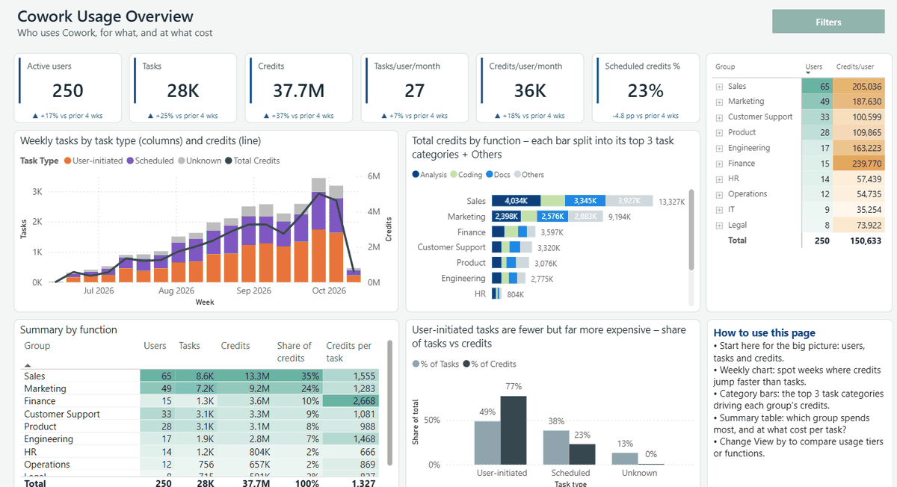

# Cowork Super User Report

**Find out who drives your Cowork spend, what they do differently, and where the credits are going next.**

Cowork usage grows fast and unevenly. A small group of people usually consumes most of the credits, scheduled automations run in the background, and organization-wide averages hide all of it. This Power BI template turns your Viva Insights Cowork export into a report that leaders can act on in a 20-minute review.

> Try it now: open the template, point it at the [`sample-data`](sample-data) folder, and refresh. The sample is fully synthetic: 250 fictional people across 10 teams (Sales, Marketing, HR, IT, and more) over 18 weeks, in the same layout as a real export. It's the data in the tour above.

## The questions it answers

| Leader question | Where to look |
|---|---|
| **Who drives most of our spend?** | **Cost Concentration**: how much of all credits the top 10% of users consume, compared with their share of tasks |
| **What are power users doing differently?** | **Cost Concentration**: a heatmap of tasks per user by function and task category, compared with everyone else |
| **Is growth coming from more use or heavier use?** | **Trends**: splits credit growth into "more tasks" and "more credits per task" |
| **Which task categories drive the increase?** | **Trends**: which categories are rising or falling, and how much of the change each one explains |
| **Which teams are gaining momentum?** | **Group Breakdown** and **Appendix – Share Shift**: which groups gain or lose share of credits over time |
| **Are we getting value for the money?** | **Value modeling – experimental**: gross value, credit cost, and net value per $1, all based on assumptions you set |
| **Where can we reduce cost safely?** | **Appendix – Deep Exploration**: scheduled versus user-initiated credits, and the task types that use the most credits |

The report starts with an **Overview** of active users, tasks, credits, and scheduled credit share, with a trend and a department split. Every page can be viewed by credit tier, task tier, function, or organization. A **Metric Glossary** and a **Category assumptions** page explain every number.

## Light it up in 3 steps

### 1. (Optional) Turn on identification to drill into individual users

The report works out of the box with the anonymized IDs in the standard export. Every page, ranking, and department view functions without identification. Turn it on only if you want to see who the individual users are. A Microsoft 365 **Global Administrator** or **AI Administrator** turns it on once:

1. In the [Microsoft 365 admin center](https://admin.cloud.microsoft/?#/viva/featureAccessManagement), go to **Settings** > **Viva** > **Feature access management**.
2. Select **Viva Insights**, choose the **identification** feature, and add a policy. You can also use PowerShell (`Add-VivaModuleFeaturePolicy`).
3. Scope the policy to the analysts who will run this report, using users or Microsoft Entra groups. You can also set a tenant-wide default.

Full details: [Identification in Copilot Analytics | Microsoft Learn](https://learn.microsoft.com/en-us/viva/insights/identification-copilot-analytics)

### 2. Export and extract

Go to [aka.ms/copilotdashboard](https://aka.ms/copilotdashboard) > **Consumption Dashboard** > **Explore Cowork** > **Export data**, and choose **Export by week**. The export downloads as a zip file. Extract it to a folder. That's all: there's no need to save, rename, or move individual files.

### 3. Open the template and refresh

Open [`CoworkSuperUser.pbit`](CoworkSuperUser.pbit) in Power BI Desktop. When it asks for **DataFolder**, paste the path of the extracted folder **without quotes**. A local folder or a SharePoint folder URL both work. Then select **Load**.

That's it. Start on **Overview**.

Need the column details or troubleshooting help? See [docs/SETUP.md](docs/SETUP.md) and [docs/TROUBLESHOOTING.md](docs/TROUBLESHOOTING.md). For a page-by-page reading guide, see the [interpretation guide](docs/INTERPRETATION_GUIDE.md) ([slides](docs/CoworkSuperUser%20Interpretation%20Guide.pptx)).

## Use it responsibly

- **Identified data is sensitive.** If you turned on identification, restrict the report and its source files to the people your identification policy allows. Apply your organization's privacy, retention, and access-control requirements.
- **Value modeling is directional.** Net value depends entirely on the assumptions you choose. It is not a measure of how important a task is. Complex, credit-heavy tasks show lower net value by design. The page is most useful for spotting credit-heavy automated tasks and asking whether they are essential.
- **The sample data is synthetic.** Don't use it to draw conclusions about real people or organizations.

## Repository layout

| Path | Contents |
|---|---|
| `CoworkSuperUser.pbit` | The Power BI template, with no data included |
| `sample-data/` | Synthetic `cowork` and `people` files you can try the template on |
| `assets/` | The report tour GIF |
| `docs/` | Setup and data contract, troubleshooting, and the interpretation guide (Markdown and slides) |
| `archive/` | Earlier releases, source projects, build tools, and media, kept for reference |

## Related

- [microsoft/Analytics-Hub](https://github.com/microsoft/Analytics-Hub): more reports and templates for Copilot Analytics, Purview, and Viva Insights
- [microsoft/DecodingSuperUsage](https://github.com/microsoft/DecodingSuperUsage): the broader Copilot super-user methodology

## Contributing, security, and license

Contributions are welcome. See [CONTRIBUTING.md](CONTRIBUTING.md). Report vulnerabilities privately as described in [SECURITY.md](SECURITY.md). This project is released under the [MIT License](LICENSE), with reference-content notices in [ATTRIBUTION.md](ATTRIBUTION.md).
